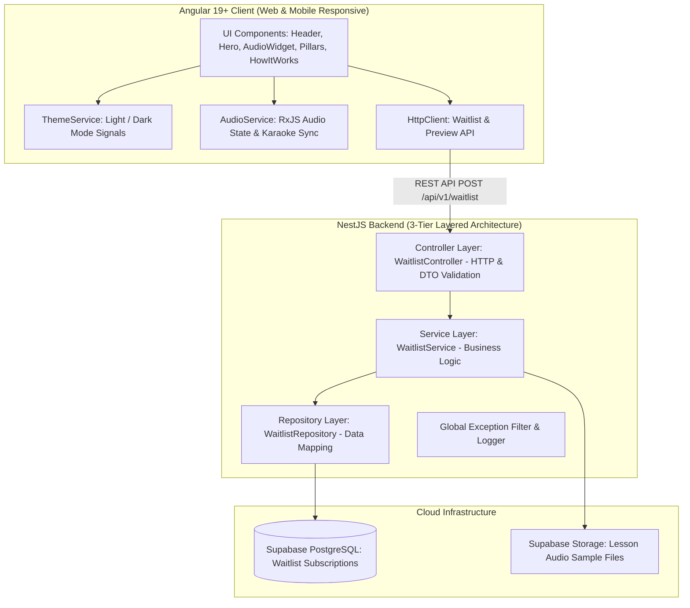

# 🚀 SPEAK-UP: Landing Page & Technical Architecture Specification

> **Version:** 1.0.0  
> **Status:** Approved (Lập kế hoạch & Thiết kế hoàn tất)  
> **Target Project:** SpeakUp - Effortless English Learning Platform  

---

## 📜 1. Decision Log (Nhật ký Quyết định)

| Quyết định | Các phương án đã xem xét | Lý do lựa chọn |
| :--- | :--- | :--- |
| **Giai đoạn 1 (MVP)** | Làm full app ngay vs. Làm từng bước (Landing Page trước) | **Làm Landing Page trước:** Giúp định hình thương hiệu, kiểm chứng nhu cầu thị trường, thu thập danh sách học viên đăng ký sớm (Waitlist) trước khi đầu tư sâu vào hệ thống bài học. |
| **Ngôn ngữ Giao diện** | Tiếng Việt vs. Tiếng Anh | **Tiếng Anh (English):** Tạo môi trường đắm mình 100% tiếng Anh ngay từ khi truy cập, bám sát triết lý Effortless English. |
| **Frontend Framework** | React / Next.js vs. Angular 19+ | **Angular 19+ (Latest):** Tối ưu vượt trội cho Audio State với Signals, tải trang siêu nhanh với `@defer` views, type-safe 100% với Signal inputs/outputs, dễ đóng gói thành Mobile App về sau. |
| **Backend Framework** | Express.js / Fastify vs. NestJS | **NestJS (TypeScript):** Đảm bảo chuẩn kiến trúc 3 lớp (3-Tier: Controller - Service - Repository), tự động validate DTO, xử lý Audio streaming & Exception Handling tập trung. |
| **Database & Cloud Storage** | MySQL / MongoDB vs. Supabase (PostgreSQL) | **Supabase (PostgreSQL Free Tier):** Cơ sở dữ liệu quan hệ mạnh mẽ, tích hợp sẵn Auth, Storage lưu trữ Audio MP3 và dễ dàng nâng cấp. |
| **Theme System** | Chỉ Light Mode vs. Chỉ Dark Mode vs. Dual Theme | **Dual Theme (Light & Dark Mode):** Hỗ trợ chuyển đổi linh hoạt qua `ThemeService` (lưu `localStorage`, đọc hệ thống `prefers-color-scheme`), mang lại cảm giác cao cấp (Premium UI). |
| **Nút bấm Call-to-Action (CTA)** | "Dashboard" vs. "Start Learning Now / Try Free Lesson" | **"Start Learning Now 🚀" & "Try Free Lesson 🎧":** Tăng mạnh tỷ lệ chuyển đổi (Conversion Rate), khơi gợi hành động học tập tức thì. |

---

## 🏛️ 2. System Architecture & Tech Stack



---

## 🎨 3. UI/UX Design & Theme Specification

### 3.1. Color System (CSS Custom Properties)
```css
:root {
  /* Brand Accent Colors */
  --color-primary: #3B82F6;
  --color-primary-hover: #2563EB;
  --color-accent-green: #10B981;
  --color-gradient-primary: linear-gradient(135deg, #3B82F6 0%, #1D4ED8 100%);
  
  /* Light Mode Palette */
  --color-bg-body: #F8FAFC;
  --color-bg-surface: #FFFFFF;
  --color-bg-surface-elevated: #F1F5F9;
  --color-border: #E2E8F0;
  --color-text-primary: #0F172A;
  --color-text-secondary: #475569;
  --color-text-muted: #94A3B8;
  --shadow-card: 0 10px 30px -5px rgba(0, 0, 0, 0.05);
}

[data-theme="dark"], body.dark {
  /* Dark Mode Palette */
  --color-bg-body: #0B0F17;
  --color-bg-surface: #151D2A;
  --color-bg-surface-elevated: #1E293B;
  --color-border: rgba(255, 255, 255, 0.08);
  --color-text-primary: #F8FAFC;
  --color-text-secondary: #94A3B8;
  --color-text-muted: #64748B;
  --shadow-card: 0 10px 30px -5px rgba(0, 0, 0, 0.4);
}
```

### 3.2. Typography
* **Primary Font:** `Plus Jakarta Sans`, sans-serif (Google Fonts).
* **Headings:** Fluid font sizing using `clamp()`, `letter-spacing: -0.02em`, `font-weight: 700/800`.

### 3.3. Component Breakdown & Responsive Behavior
1. **Header Component (`app-header`):**
   * Logo "SpeakUp" với hiệu ứng hover gradient.
   * Menu điều hướng ("The Method", "How It Works").
   * Nút Theme Toggle (Moon / Sun icon) chuyển đổi mượt mờ.
   * Nút CTA: `Try Demo 🎧` / `Start Learning 🚀`.
2. **Hero Section (`app-hero`):**
   * Badge *"Master English Naturally 🚀"*.
   * Tiêu đề: *"Stop Studying Grammar. Start **Speaking** English."* (Highlight từ *"Speaking"* bằng màu xanh lá/gradient).
   * 2 Nút bấm: `Start Learning Now 🚀` (Primary) và `Listen Preview 🎧` (Secondary).
   * **Interactive Audio Widget:** Phát mẫu audio thật *"Dragons (Mini-Story) - A.J. Hoge"*, tự động đổi màu dòng chữ transcript khi phát.
3. **The 4 Pillars of Fluency (`app-pillars`):**
   * Grid 4 cột (Mobile: 1 cột).
   * 4 Card: *Main Audio Article*, *Vocabulary Lesson*, *Mini-Story (Q&A)* (Active Highlight), *Point of View Story*.
   * Hiệu ứng 3D Mouse Parallax Tilt khi di chuột qua Card.
4. **How It Works (`app-how-it-works`):**
   * 4 bước lộ trình trượt mượt khi cuộn trang: `01 Listen & Read`, `02 Understand Deeply`, `03 Answer & Respond`, `04 Master Grammar`.
5. **CTA Banner & Footer (`app-cta-banner`, `app-footer`):**
   * Card banner màu tối gradient nổi bật với tiêu đề *"Ready to Speak English Effortlessly?"*.
   * Form đăng ký nhận trải nghiệm sớm (Waitlist Form Modal).

---

## 🛠️ 4. Backend API Specification (NestJS)

### 4.1. Endpoint: Register Waitlist
* **Route:** `POST /api/v1/waitlist`
* **Headers:** `Content-Type: application/json`
* **Request DTO (`CreateWaitlistDto`):**
  ```typescript
  export class CreateWaitlistDto {
    @IsEmail({}, { message: 'Invalid email address format' })
    @IsNotEmpty({ message: 'Email is required' })
    email: string;

    @IsString()
    @IsOptional()
    fullName?: string;
  }
  ```
* **Response `201 Created`:**
  ```json
  {
    "statusCode": 201,
    "message": "Successfully subscribed to SpeakUp waitlist!",
    "data": {
      "id": "e3b0c442-98fc-11ee-b9d1-0242ac120002",
      "email": "student@example.com",
      "createdAt": "2026-09-24T16:45:00.000Z"
    }
  }
  ```
* **Response `400 Bad Request` (Validation Error):**
  ```json
  {
    "statusCode": 400,
    "message": ["Invalid email address format"],
    "error": "Bad Request"
  }
  ```

---

## 🚀 5. Implementation Roadmap (Kế hoạch Triển khai)

### Bước 1: Khởi tạo Cấu trúc Dự án (Project Setup)
* Khởi tạo NestJS Backend (`apps/api`) & Angular 19+ Frontend (`apps/web`).
* Cấu hình Tailwind CSS / SCSS với CSS Variables cho Dark/Light Theme.
* Thiết lập kết nối Supabase PostgreSQL với TypeORM / Prisma.

### Bước 2: Phục dựng Giao diện Frontend Landing Page
* Xây dựng `HeaderComponent`, `ThemeService` (chuyển đổi Light/Dark mode).
* Xây dựng `HeroComponent` & `AudioPlayerWidgetComponent` (tích hợp audio sample & Karaoke text sync).
* Xây dựng `PillarsComponent` với hiệu ứng 3D Mouse Parallax Tilt.
* Xây dựng `HowItWorksComponent` & `CtaBannerComponent`.

### Bước 3: Phát triển Backend API & Tích hợp
* Xây dựng `WaitlistModule`, `WaitlistController`, `WaitlistService`, `WaitlistRepository`.
* Cấu hình Global Exception Filter & Logging Filter.
* Kết nối Form đăng ký ở Frontend với Backend API.

### Bước 4: Verification & Polishing
* Kiểm tra Responsive trên Mobile (375px), Tablet (768px) và Laptop/Desktop (1440px).
* Kiểm tra hiệu năng LCP, CLS, Accessibility và Dark/Light mode switching.
