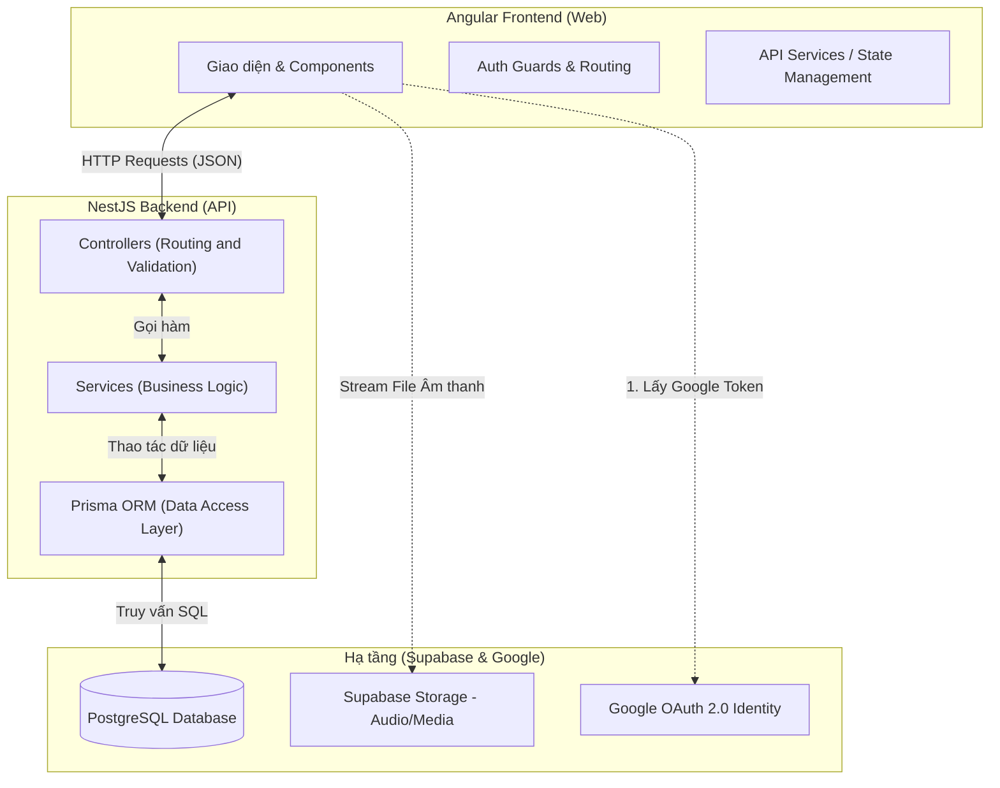

# Tài liệu Thiết kế Hệ thống (System Architecture Document)
## Dự án: SpeakUp (Effortless English Platform)

### 1. Tổng quan dự án (Project Overview)
SpeakUp là nền tảng học tiếng Anh dựa trên phương pháp Effortless English (AJ Hoge), tập trung vào "Deep Learning" (Học sâu), luyện phản xạ qua Mini-Story và giữ chân người dùng bằng Gamification (Game hóa) và Spaced Repetition (Lặp lại ngắt quãng).

### 2. Kiến trúc công nghệ (Tech Stack)
- **Frontend:** Angular (v21+), SCSS (Premium UI, Glassmorphism, CSS Variables cho Light/Dark mode).
- **Backend:** NestJS (v11), RESTful API, Prisma ORM.
- **Database & Storage:** Supabase (PostgreSQL), Supabase Storage (lưu trữ Audio, Image).
- **Authentication:** Google OAuth 2.0 (Identity Services) kết hợp JWT nội bộ của hệ thống.

### 3. Sơ đồ Kiến trúc (High-Level Architecture)

### 4. Từ điển Dữ liệu Chi tiết (Detailed Data Dictionary)

Hệ thống xoay quanh 3 trụ cột chính. Dưới đây là giải thích chi tiết ý nghĩa từng cột dưới dạng bảng.

**Bảng Tổng hợp Giải thích Ý nghĩa Các Bảng:**
| Tên Bảng (Database Table) | Ý nghĩa / Giải thích vai trò |
| :--- | :--- |
| `courses` | Lưu trữ các bộ khóa học lớn (VD: Flow English, Original English). |
| `lessons` | Lưu các bài học cụ thể thuộc một khóa học (VD: Baseball Pig). |
| `lesson_sections` | Chia 1 bài học thành nhiều phần (Main Article, Vocab, Mini-Story) để render ra nhiều Tab. |
| `lesson_vocabularies` | Lưu kho từ mới của từng bài học kèm phiên âm và giải nghĩa. |
| `users` | Lưu tài khoản người dùng, tổng điểm XP và số ngày Streak liên tiếp. |
| `activity_logs` | Ghi log lịch sử hoạt động để tính toán XP (VD: nghe audio, hoàn thành bài). |
| `user_progress` | Lưu tiến độ Deep Learning của từng bài (Số lần nghe, số ngày lặp lại). |
| `user_vocab_reviews` | Hệ thống thẻ Flashcard phục vụ thuật toán Lặp lại ngắt quãng (Spaced Repetition). |

#### 4.1. Trụ cột 1: Kho Nội dung (Content)
Lưu trữ toàn bộ tài nguyên học liệu tĩnh của phương pháp Effortless English.

**Bảng `courses` (Khóa học):** Lưu các bộ khóa học lớn.
| Tên cột | Kiểu dữ liệu | Mô tả chi tiết |
| :--- | :--- | :--- |
| `id` | UUID | Khóa chính. |
| `slug` | String | URL thân thiện chuẩn SEO (VD: `flow-english`). Dùng để tạo link đẹp. |
| `title` | String | Tên khóa học (VD: "Flow English"). |
| `description` | String | Đoạn văn mô tả khóa học. |
| `thumbnail_url` | String | Link ảnh bìa khóa học. |
| `display_order` | Int | Số thứ tự để sắp xếp khóa hiện trước hay hiện sau trên màn hình. |

**Bảng `lessons` (Bài học):** Lưu các bài học cụ thể thuộc một khóa học.
| Tên cột | Kiểu dữ liệu | Mô tả chi tiết |
| :--- | :--- | :--- |
| `id` | UUID | Khóa chính. |
| `course_id` | UUID | Khóa ngoại liên kết tới bảng `courses`. |
| `slug` | String | URL thân thiện (VD: `baseball-pig`). |
| `title` | String | Tên bài học. |
| `description` | String | Lời tựa giới thiệu bài học. |
| `thumbnail_url` | String | Ảnh bìa riêng của bài học (nếu có). |
| `display_order` | Int | Thứ tự của bài học trong khóa (Bài 1, Bài 2...). |

**Bảng `lesson_sections` (Các phân mục trong bài):** Giúp 1 bài học chia ra thành nhiều Tab (Main, Vocab, Mini-Story A/B/C).
| Tên cột | Kiểu dữ liệu | Mô tả chi tiết |
| :--- | :--- | :--- |
| `id` | UUID | Khóa chính. |
| `lesson_id` | UUID | Khóa ngoại liên kết với `lessons`. |
| `section_type` | Enum | Định hướng giao diện (UI) cho Frontend render: 1. **`MAIN_ARTICLE`**: Có Audio Player & đoạn Text hiển thị văn bản. 2. **`VOCABULARY`**: Hiển thị danh sách từ mới và giải thích (bằng tiếng Anh). 3. **`MINI_STORY`**: Chỉ có Audio Player. 4. **`POV`**: Chỉ có Audio Player. 5. **`COMMENTARY`**: Chỉ có Audio Player. |
| `title` | String | Tiêu đề hiển thị cho tab (VD: "Mini Story A"). |
| `audio_url` | String | Link truy cập file âm thanh trên Supabase Storage (Bỏ trống nếu tab chỉ có chữ). |
| `content` | Text | Nội dung bài đọc (Transcript) đồng bộ với âm thanh. |
| `display_order` | Int | Thứ tự sắp xếp các tab từ trái qua phải. |

**Bảng `lesson_vocabularies` (Kho từ vựng):** Chứa danh sách các từ mới xuất hiện trong bài.
| Tên cột | Kiểu dữ liệu | Mô tả chi tiết |
| :--- | :--- | :--- |
| `id` | UUID | Khóa chính. |
| `lesson_id` | UUID | Khóa ngoại liên kết với `lessons`. |
| `word` | String | Từ vựng gốc tiếng Anh (VD: `Exhausted`). |
| `part_of_speech` | String | Loại từ (VD: `adj`, `noun`, `verb`). |
| `phonetic` | String | Cách phát âm quốc tế IPA (VD: `/ɪɡˈzɔː.stɪd/`). |
| `meaning` | String | Giải nghĩa bằng tiếng Anh (English Explanation). |
| `example_sentence` | Text | Câu ví dụ để người dùng hiểu ngữ cảnh. |

#### 4.2. Trụ cột 2: Người dùng & Gamification
Quản lý thông tin tài khoản và hệ thống tạo động lực học tập.

**Bảng `users` (Tài khoản người dùng):**
| Tên cột | Kiểu dữ liệu | Mô tả chi tiết |
| :--- | :--- | :--- |
| `id` | UUID | Khóa chính. |
| `email` | String | Email đăng nhập qua Google. |
| `full_name` | String | Tên hiển thị trên Dashboard. |
| `avatar_url` | String | Link ảnh đại diện lấy từ Google. |
| `total_xp` | Int | Tổng điểm kinh nghiệm người dùng đã tích lũy (Dùng để đua Top hoặc đổi thưởng). |
| `current_streak` | Int | Chuỗi số ngày đăng nhập & học liên tiếp (VD: Đang học chuỗi 5 ngày). |
| `last_active_date` | DateTime | Thời điểm học bài cuối cùng. (Dùng để kiểm tra nếu qua 24h mà chưa học thì sẽ reset `current_streak` về 0). |

**Bảng `activity_logs` (Lịch sử hoạt động):**
| Tên cột | Kiểu dữ liệu | Mô tả chi tiết |
| :--- | :--- | :--- |
| `id` | UUID | Khóa chính. |
| `user_id` | UUID | Khóa ngoại xác định người thực hiện. |
| `action_type` | String | Hành động vừa làm (VD: `LISTEN_MINI_STORY`, `COMPLETE_LESSON`). |
| `xp_earned` | Int | Số điểm XP nhận được từ hành động này. |
| `created_at` | DateTime | Thời điểm thực hiện (Dùng để vẽ biểu đồ Tần suất học tập trong tuần/tháng). |

#### 4.3. Trụ cột 3: Theo dõi Tiến độ (Deep Learning & Spaced Repetition)
Nơi kết nối Người dùng với Nội dung, đảm bảo họ học đúng phương pháp AJ Hoge.

**Bảng `user_progress` (Tiến độ Bài học - Deep Learning):**
| Tên cột | Kiểu dữ liệu | Mô tả chi tiết |
| :--- | :--- | :--- |
| `id` | UUID | Khóa chính. |
| `user_id` | UUID | Khóa ngoại xác định Người dùng. |
| `lesson_id` | UUID | Khóa ngoại xác định Bài học. |
| `status` | Enum | Trạng thái (`NOT_STARTED`, `IN_PROGRESS`, `COMPLETED`). |
| `completion_percentage`| Int | Tỷ lệ % hoàn thành các section trong bài. |
| `days_repeated` | Int | **QUAN TRỌNG** - Tổng số ngày người dùng đã nghe bài này. (Giúp App nhắc nhở học đủ 7-14 ngày theo chuẩn Effortless). |
| `listen_count` | Int | Tổng số lần bấm nút Play nghe bài này. |
| `last_played_at` | DateTime | Thời điểm nghe gần nhất. |

**Bảng `user_vocab_reviews` (Hệ thống Thẻ Flashcard):** Quản lý thuật toán Lặp lại ngắt quãng (SRS).
| Tên cột | Kiểu dữ liệu | Mô tả chi tiết |
| :--- | :--- | :--- |
| `id` | UUID | Khóa chính. |
| `user_id` | UUID | Khóa ngoại xác định Người dùng. |
| `vocabulary_id` | UUID | Khóa ngoại xác định Từ vựng. |
| `status` | Enum | Trạng thái học của từ (`NEW`, `LEARNING`, `REVIEWING`, `MASTERED`). |
| `next_review_date` | DateTime | Ngày tới hạn hệ thống sẽ "báo thức" bắt người dùng ôn lại từ này. |
| `interval_days` | Int | Khoảng cách ngày ôn tập hiện tại (VD: Nhớ tốt thì khoảng cách tăng từ 1 -> 3 -> 7 -> 21 ngày). |
| `ease_factor` | Float | Hệ số đo lường độ khó của từ đối với riêng user này (Từ càng khó nhớ thì hệ số càng thấp, bắt ôn lại càng nhiều). |
| `repetition_count` | Int | Số lần lật thẻ và trả lời ĐÚNG liên tiếp. |

### 5. Nguyên tắc Thiết kế API (API Design Standard)
Tuân thủ mô hình 3 lớp (3-Tier Architecture) nghiêm ngặt:
- **Controller Layer:** Chỉ nhận HTTP Request, Validate dữ liệu đầu vào bằng DTO, chuyển cho Service, và trả về HTTP Response.
- **Service Layer:** Chứa toàn bộ logic tính toán nghiệp vụ (Ví dụ: tính toán ngày ôn tập Flashcard tiếp theo, cộng dồn Streak).
- **Repository/ORM Layer:** Giao tiếp với DB thông qua Prisma.

### 6. Luồng Nghiệp vụ cốt lõi (Core Business Flows)

#### 6.1. Luồng Xác thực (Authentication Flow)
1. Người dùng bấm "Tiếp tục với Google" trên Frontend.
2. Google bật popup, người dùng chọn tài khoản, Google trả về `credential_token` (JWT).
3. Frontend gửi Token này lên API `POST /api/v1/auth/google` của Backend.
4. Backend giải mã token, xác minh với Google. Nếu hợp lệ, tìm hoặc tạo dòng dữ liệu mới trong bảng `Users`.
5. Backend tự sinh ra 1 **Access Token (JWT)** riêng của SpeakUp, trả về cho Frontend.
6. Frontend lưu Token này vào `localStorage` và đính kèm vào Header (`Authorization: Bearer ...`) trong các lần gọi API tiếp theo để bảo mật.

#### 6.2. Luồng Học bài (Lesson & Deep Learning Flow)
1. Người dùng chọn 1 Lesson qua đường dẫn thân thiện (VD: `/learn/flow-english/baseball-pig`).
2. Frontend gọi API lấy thông tin Lesson (bao gồm tất cả các Sections Audio và Vocabularies).
3. Giao diện render hệ thống Tabs (Main, Vocab, Mini-Story...).
4. Mỗi khi người dùng hoàn thành 1 lượt nghe Mini-Story, Frontend gọi API `POST /api/v1/progress/record`.
5. Backend nhận yêu cầu: Tăng `listen_count`, kiểm tra nếu là ngày mới thì tăng `days_repeated` và `current_streak` trong `users`, đồng thời cộng điểm `xp_earned` lưu vào log hoạt động.
