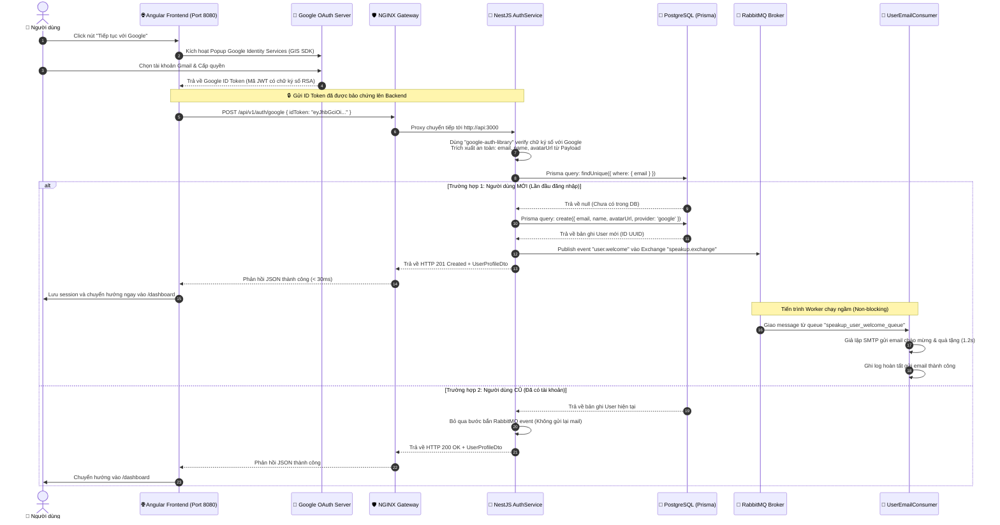

# Tài liệu Kỹ thuật: Tính năng Đăng nhập Google (Google OAuth 2.0 Authentication)

> **Mã tính năng:** `FEATURE-01-GOOGLE-AUTH`  
> **Trạng thái:** Hoàn thành (Completed)  
> **OAuth Client ID:** `996712067238-iuk0jcbrfjfcupqs4re96i1f2m8bg8hk.apps.googleusercontent.com`  
> **Mục tiêu:** Cho phép người dùng đăng nhập an toàn bằng tài khoản Google, tự động phân nhánh người dùng mới/cũ trong PostgreSQL, và kích hoạt gửi email chào mừng bất đồng bộ qua RabbitMQ.

---

## 1. Bài toán & Mục tiêu Thiết kế (Problem & Objectives)

### 1.1. Bài toán thực tế
- Người dùng không muốn tạo thêm tài khoản mật khẩu mới (dễ quên, ngại đăng ký).
- Hệ thống cần xác thực danh tính chính xác (email thật đã được Google chứng thực).
- Hệ thống phải tuyệt đối an toàn: **Frontend không được phép gửi email thô lên backend**, vì kẻ xấu có thể dùng Postman giả mạo email của người khác để đánh cắp tài khoản.

### 1.2. Mục tiêu đạt được
1. **Xác thực Không mật khẩu (Passwordless):** Người dùng đăng nhập chỉ với 1 click bằng tài khoản Google.
2. **Bảo mật chuẩn Quốc tế (Google ID Token Verification):** Backend trực tiếp dùng khóa công khai của Google để giải mã và xác minh tính toàn vẹn của mã thông báo (ID Token JWT).
3. **Phân nhánh nghiệp vụ thông minh (New vs Returning User):**
   - **User mới:** Ghi vào bảng `users` trong PostgreSQL $\rightarrow$ Bắn sự kiện `user.welcome` vào RabbitMQ $\rightarrow$ Worker gửi email lộ trình học ngầm dưới nền.
   - **User cũ:** Bỏ qua gửi email, cấp quyền truy cập ngay lập tức.
4. **Trải nghiệm mượt mà (< 30ms phản hồi HTTP):** Tách rời hoàn toàn tác vụ gửi email nặng nề ra khỏi luồng xử lý chính.

---

## 2. Sơ đồ Chuỗi Hoạt động (Sequence Flow Diagram)



---

## 3. Cơ chế Bảo mật Chuyên sâu (Security Deep Dive)

### 3.1. Tại sao KHÔNG truyền Email trực tiếp từ Frontend?
- **Lỗ hổng giả mạo (Impersonation Attack):** Nếu API nhận payload `{ email: "victim@gmail.com" }`, kẻ tấn công chỉ cần mở công cụ gửi HTTP (Postman/Curl) và gửi email của bất kỳ ai để đăng nhập vào tài khoản của người đó.
- **Giải pháp Google ID Token:** Frontend chỉ nhận được một chuỗi JWT từ máy chủ Google sau khi người dùng đã xác thực mật khẩu/vân tay thành công trên giao diện của chính Google.

### 3.2. Google ID Token hoạt động như thế nào?
Google ID Token là một chuỗi JWT gồm 3 phần (`header.payload.signature`):
1. **Header:** Chứa thuật toán mã hóa (ví dụ `RS256`) và mã khóa (`kid`).
2. **Payload:** Chứa thông tin người dùng được mã hóa Base64:
   ```json
   {
     "iss": "https://accounts.google.com",
     "sub": "1098472948294729184",        // ID người dùng duy nhất của Google
     "email": "user@gmail.com",
     "email_verified": true,               // Đảm bảo email đã được Google kiểm chứng
     "name": "Nguyen Van A",
     "picture": "https://lh3.googleusercontent.com/...",
     "aud": "996712067238-iuk0jcbrfjfcupqs4re96i1f2m8bg8hk.apps.googleusercontent.com",
     "exp": 1791234567                     // Hạn sử dụng (chỉ sống trong ~1 giờ)
   }
   ```
3. **Signature (Chữ ký điện tử):** Google dùng **Khóa bí mật (Private Key)** của họ để ký.

### 3.3. Cách Backend xác thực Token (`google-auth-library`):
- Backend tải danh sách **Khóa công khai (Public Keys)** từ máy chủ chứng chỉ của Google (`https://www.googleapis.com/oauth2/v3/certs`).
- Kiểm tra tính toàn vẹn của chữ ký số: Nếu chuỗi token bị kẻ xấu sửa đổi dù chỉ 1 ký tự, chữ ký sẽ không khớp và bị từ chối ngay lập tức (`401 Unauthorized`).
- Kiểm tra `audience`: Token phải được sinh ra cho đúng `GOOGLE_CLIENT_ID` của SpeakUp, ngăn chặn kẻ xấu dùng token lấy được từ ứng dụng khác để đăng nhập vào SpeakUp.
- Kiểm tra thời hạn `exp`: Token đã hết hạn sẽ bị từ chối.

### 3.4. Client ID có cần bảo mật không?
- **Client ID là định danh công khai (Public Identifier):**
  - Không cần bảo mật bí mật, vì mã này bắt buộc phải xuất hiện ở Frontend (Angular) để Google biết ứng dụng nào đang gọi đến. Bất kỳ ai bấm F12 xem source code đều thấy được Client ID này.
- **Lớp bảo vệ thực sự nằm ở đâu?**
  - Chính là cấu hình **Authorized JavaScript origins** (`http://localhost:8080`) trên Google Cloud Console!
  - Kẻ xấu dù copy `Client ID` của bạn sang website lạ của họ thì khi người dùng bấm đăng nhập, Google sẽ phát hiện tên miền không nằm trong danh sách và lập tức chặn đứng với lỗi `origin_mismatch`.
- **Thứ cần bảo mật tuyệt đối:**
  - Đó là **Client Secret** (Khóa bí mật). Khóa này chỉ dùng cho backend-to-backend và tuyệt đối không bao giờ được đưa vào mã nguồn frontend hay public git. *(Với chuẩn Google Identity Services GIS hiện tại, ứng dụng web SPA chỉ cần Client ID, hoàn toàn không cần Client Secret)*.

---

## 4. Các File Mã Nguồn Tham Gia vào Tính Năng

### 4.1. Phía Backend (NestJS API — `apps/api`)
| Tệp mã nguồn | Vai trò kỹ thuật |
| :--- | :--- |
| `src/modules/auth/dto/google-login.dto.ts` | DTO tiếp nhận và validate `idToken` từ request gửi lên |
| `src/modules/auth/dto/auth-response.dto.ts` | DTO chuẩn hóa dữ liệu trả về cho client (không rò rỉ model DB) |
| `src/modules/auth/auth.service.ts` | Khởi tạo `OAuth2Client`, verify token với Google, query Prisma, publish RabbitMQ |
| `src/modules/auth/auth.controller.ts` | Tiếp nhận endpoint `POST /api/v1/auth/google` |
| `src/modules/auth/consumers/user-email.consumer.ts` | Worker lắng nghe queue `speakup_user_welcome_queue` để gửi email |
| `src/infrastructure/prisma/prisma.service.ts` | Giao tiếp cơ sở dữ liệu PostgreSQL lưu trữ bảng `users` |
| `src/infrastructure/rabbitmq/rabbitmq.module.ts` | Cung cấp kết nối tới RabbitMQ exchange `speakup.exchange` |

### 4.2. Phía Frontend (Angular 19 — `apps/web`)
| Tệp mã nguồn | Vai trò kỹ thuật |
| :--- | :--- |
| `src/index.html` | Nhúng thư viện Google Identity Services (`https://accounts.google.com/gsi/client`) |
| `src/app/components/auth/auth.component.ts` | Khởi tạo Google Button / Popup GIS qua `AfterViewInit` và lắng nghe callback |
| `src/app/services/auth.service.ts` | Gửi `idToken` lên `/api/v1/auth/google`, lưu thông tin vào `localStorage` |

---

## 5. Cấu hình Google Cloud Console Hiện tại

- **Dự án:** `speak-up`
- **Client ID:** `996712067238-iuk0jcbrfjfcupqs4re96i1f2m8bg8hk.apps.googleusercontent.com`
- **Authorized JavaScript origins:**
  - `http://localhost:8080` (Cổng NGINX Gateway chính thức của Web)
  - `http://localhost:3000` (Cổng Backend API)
- **Authorized redirect URIs:** Để trống (sử dụng Token Popup flow)

---

## 6. Kế hoạch Kiểm thử & Tiêu chí Nghiệm thu (Verification & Acceptance Criteria)

### Tiêu chí Thành công (Definition of Done):
- [x] Tạo thành công Google OAuth 2.0 Client ID trên Google Cloud Console.
- [x] Nhúng Google Identity Services SDK và render nút đăng nhập Google trên Angular.
- [x] Bấm nút Google mở popup đăng nhập chính thức của Google mà không bị chặn nguồn gốc.
- [x] Backend dùng `google-auth-library` verify thành công Google ID Token, từ chối token giả mạo với `401 Unauthorized`.
- [x] Dữ liệu được ghi vào bảng `users` trong PostgreSQL (tên cột theo chuẩn `snake_case`).
- [x] RabbitMQ nhận được sự kiện `user.welcome` khi user đăng nhập lần đầu và Worker hoàn thành gửi mail.
- [x] Khi user cũ đăng nhập lần thứ 2, hệ thống trả về thành công ngay lập tức và KHÔNG kích hoạt RabbitMQ gửi lại mail.
- [x] Giao diện Web tự động điều hướng vào `/dashboard` và hiển thị avatar + họ tên tài khoản Google.
