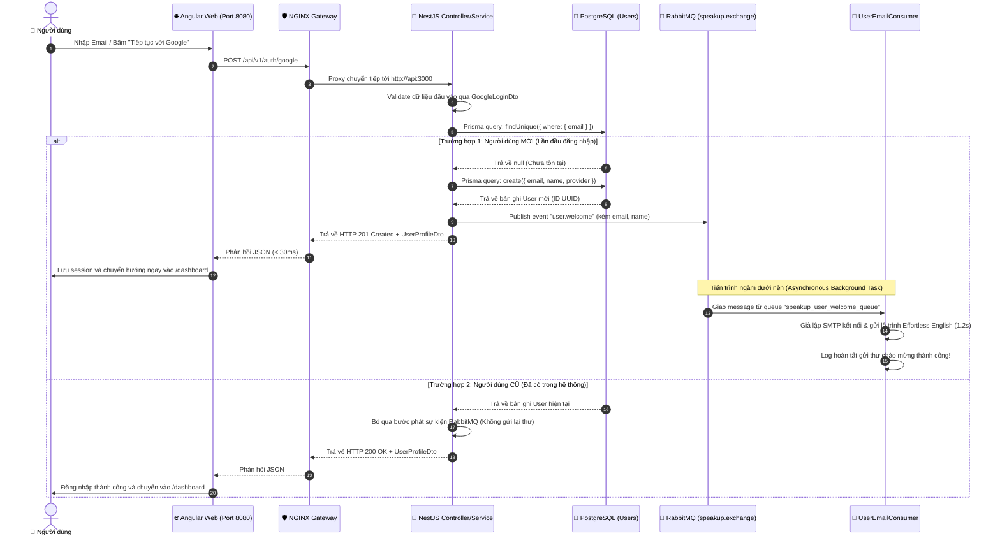
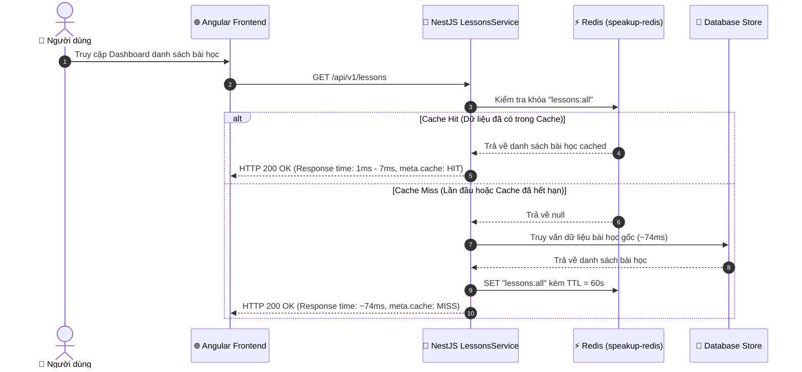

# Kiến trúc Hệ thống SPEAK-UP (System Architecture Documentation)

> Tài liệu mô tả chi tiết thiết kế kiến trúc tổng thể, mô hình phân tầng, vai trò của từng công nghệ và các luồng xử lý dữ liệu chính trong nền tảng học tiếng Anh Effortless English - **SPEAK-UP**.

---

## 1. Tổng quan Kiến trúc Hệ thống (High-Level Architecture)

Hệ thống **SPEAK-UP** được thiết kế theo mô hình **Containerized Microservices-Ready Architecture** kết hợp với **Event-Driven Architecture (EDA)**. Toàn bộ các thành phần được điều phối thông qua Docker Compose, cô lập trong một mạng nội bộ ảo (`speakup-network`), với **NGINX** đóng vai trò là Cổng vào duy nhất (Single Entry Point / API Gateway).

### 1.1. Sơ đồ Kiến trúc Tổng thể (System Diagram)

```mermaid
graph TD
    Client["👤 Người dùng (Trình duyệt Web)"]
    
    subgraph Host_Environment ["🖥️ Docker Host (Mạng speakup-network)"]
        subgraph Gateway_Tier ["🌐 Cổng vào & Web Server"]
            Nginx["NGINX Reverse Proxy (Port 8080)<br/>• Gzip Compression<br/>• Static Asset Caching<br/>• API Routing & Triệt tiêu CORS"]
        end
        
        subgraph Presentation_Tier ["🎨 Lớp Giao diện (Frontend)"]
            Angular["Angular 19 SPA (Container: speakup-web)<br/>• Standalone Components<br/>• Angular Signals State Management<br/>• HttpClient Module"]
        end

        subgraph Application_Tier ["🚀 Lớp Ứng dụng (Backend API)"]
            NestAPI["NestJS API (Container: speakup-api:3000)<br/>• 3-Tier Layered Architecture<br/>• Global Exception Filter<br/>• DTO Validation & Transformation<br/>• Producer & Consumer Workers"]
        end

        subgraph In_Memory_Tier ["⚡ Lớp Bộ nhớ Đệm (Cache & Security)"]
            Redis["Redis 7 Alpine (Container: speakup-redis:6379)<br/>• Cache-Aside Pattern (TTL 60s)<br/>• Atomic Rate Limiting (INCR + EXPIRE)<br/>• Tốc độ phản hồi < 10ms"]
        end

        subgraph Messaging_Tier ["🐰 Lớp Hàng đợi Bất đồng bộ (Message Broker)"]
            RabbitMQ["RabbitMQ 3 Management (Container: speakup-rabbitmq:5672/15672)<br/>• Topic Exchange (speakup.exchange)<br/>• Dead Letter Exchange (speakup.dlx)<br/>• Queues: user_welcome, waitlist_email, DLQ"]
        end

        subgraph Persistence_Tier ["🐘 Lớp Cơ sở Dữ liệu Quan hệ"]
            Postgres["PostgreSQL 16 Alpine (Container: speakup-postgres:5432)<br/>• Prisma ORM 6 Engine<br/>• Bảng users (snake_case columns)<br/>• ACID Transactions & Data Persistence"]
        end
    end

    %% Luồng tương tác
    Client -->|HTTP Request| Nginx
    Nginx -->|Route '/' - Tải SPA & Assets| Angular
    Nginx -->|Route '/api/*' - Reverse Proxy| NestAPI
    
    NestAPI <-->|1. Kiểm tra / Lưu Cache & Rate Limit| Redis
    NestAPI <-->|2. Truy vấn / Ghi dữ liệu ORM| Postgres
    NestAPI -->|3. Publish Events (user.welcome, waitlist.registered)| RabbitMQ
    RabbitMQ -->|4. Push Message tới Consumers (Workers ngầm)| NestAPI
```

---

## 2. Chi tiết Vai trò của Từng Khối Công nghệ

### 2.1. NGINX — Cổng vào Tập trung, Reverse Proxy & Web Server
- **Vị trí:** Đứng ở tiền tuyến tiếp nhận toàn bộ lưu lượng truy cập tại cổng `8080`.
- **Vai trò kỹ thuật:**
  1. **Single Entry Point & API Gateway:** 
     - Mọi request của người dùng chỉ cần hướng tới một cổng duy nhất (`http://localhost:8080`).
     - Request bắt đầu bằng `/api/` được chuyển tiếp tự động sang container backend `http://api:3000`.
     - Các request giao diện tĩnh `/` được phục vụ trực tiếp từ bản build Angular.
  2. **Triệt tiêu 100% lỗi CORS:** Do cả Frontend và Backend đều chung một Domain/Origin từ góc nhìn của trình duyệt (`localhost:8080`), bài toán cấu hình CORS phức tạp giữa các domain được giải quyết triệt để.
  3. **SPA Fallback Routing:** Cấu hình `try_files $uri $uri/ /index.html;` đảm bảo khi người dùng F5 tải lại trang tại các đường dẫn con (`/dashboard`, `/auth`), NGINX tự động trả về `index.html` để Angular Router xử lý, tránh lỗi `404 Not Found`.
  4. **Tối ưu hóa Băng thông & Hiệu năng:** Kích hoạt nén Gzip (`gzip on`) giúp giảm tới ~70% dung lượng HTML/JS/CSS và thiết lập chính sách Browser Caching (`max-age=31536000, immutable`) cho tài nguyên tĩnh.

---

### 2.2. Frontend — Angular 19 SPA (Single Page Application)
- **Vị trí:** Đóng gói trong container `speakup-web`, build qua Multi-stage Dockerfile ra static bundle (~25MB image NGINX).
- **Vai trò kỹ thuật:**
  1. **Kiến trúc Hiện đại:** Áp dụng Standalone Components và **Angular Signals** (`currentUser`, `isLoading`, `lastAuthNotice`) để quản lý trạng thái phản ứng (reactive state) tức thì.
  2. **Tích hợp Backend chuẩn RESTful:** Sử dụng `provideHttpClient()` kết hợp `firstValueFrom` để gọi các API `/api/v1/auth/google`, `/api/v1/lessons` thông qua NGINX reverse proxy.
  3. **Xử lý Session người dùng:** Lưu trữ thông tin đăng nhập vào `localStorage` và bảo vệ phiên làm việc qua Router Guards.

---

### 2.3. Backend API — NestJS Framework (3-Tier Layered Architecture)
- **Vị trí:** Chạy trên Node.js 20 Alpine (`speakup-api`), cổng nội bộ `3000`.
- **Vai trò kỹ thuật & Luật Kiến trúc (Clean Architecture):**
  1. **Controller Layer:** Chỉ tiếp nhận HTTP Request, áp dụng Validation Pipe thông qua DTO (`GoogleLoginDto`, `CreateWaitlistDto`), ủy quyền xử lý cho Service và trả lời HTTP Status Code phù hợp (`200 OK`, `201 Created`, `400 Bad Request`, `429 Too Many Requests`).
  2. **Service Layer:** Tập trung toàn bộ Business Logic của hệ thống (quyết định user mới hay cũ, gọi Prisma ORM, kiểm tra Redis cache, phát sự kiện vào RabbitMQ).
  3. **Data Transfer Object (DTO) Protection:** Không bao giờ để lộ Entity / Model thô của Database ra Client; luôn bọc và ánh xạ sang DTO (`UserProfileDto`, `AuthResponseDto`).
  4. **Global Exception Handling:** Trang bị `AllExceptionsFilter` bao quát toàn bộ lỗi hệ thống, trả về định dạng JSON thống nhất có cấu trúc:
     ```json
     {
       "statusCode": 400,
       "timestamp": "2026-10-06T13:53:38.868Z",
       "path": "/api/v1/auth/google",
       "error": { "message": ["Email không đúng định dạng"], "statusCode": 400 }
     }
     ```

---

### 2.4. PostgreSQL 16 & Prisma ORM 6 — Lưu trữ Dữ liệu Bền vững
- **Vị trí:** Database container `speakup-postgres` kết nối qua named volume `speakup_postgres_data`.
- **Vai trò kỹ thuật:**
  1. **Tính Toàn vẹn Dữ liệu (ACID):** Đảm bảo an toàn, không bao giờ mất dữ liệu khi restart hoặc container gặp sự cố.
  2. **Prisma ORM Type-Safe:** Tự động sinh TypeScript Types, ngăn ngừa hoàn toàn lỗi sai kiểu và lỗi SQL Injection nhờ cơ chế Prepared Statements.
  3. **Chuẩn hóa Đặt tên (Naming Conventions):**
     - **Database level:** Sử dụng chuẩn `snake_case` cho tên bảng (`users`) và tên cột (`avatar_url`, `created_at`, `updated_at`).
     - **Code level:** Sử dụng chuẩn `camelCase` cho thuộc tính TypeScript (`avatarUrl`, `createdAt`, `updatedAt`) thông qua các directive `@map` và `@@map` trong `schema.prisma`.

---

### 2.5. Redis 7 — In-Memory Cache & Rate Limiting
- **Vị trí:** Container `speakup-redis` trên cổng `6379`.
- **Vai trò kỹ thuật:**
  1. **Cache-Aside Pattern:**
     - Giảm tải trực tiếp cho Database.
     - Khi có request `GET /api/v1/lessons`: kiểm tra Redis trước. Nếu **Cache Hit**, trả về ngay lập tức với độ trễ siêu thấp (< 10ms so với ~74ms khi query DB). Nếu **Cache Miss**, nạp dữ liệu từ DB, lưu vào Redis kèm TTL (Time-To-Live = 60s) rồi trả về cho client.
     - Hỗ trợ endpoint xóa cache chủ động (`DELETE /api/v1/lessons/cache`) phục vụ **Cache Invalidation**.
  2. **Atomic Rate Limiter (Chống Spam / Brute-Force):**
     - Sử dụng các lệnh nguyên tử của Redis (`INCR` + `EXPIRE`) theo khóa IP của người gọi (`ratelimit:{ip}:{path}`).
     - Trả về mã lỗi chuẩn `HTTP 429 Too Many Requests` khi vượt ngưỡng cho phép, bảo vệ server khỏi bị tấn công từ chối dịch vụ.

---

### 2.6. RabbitMQ 3 — Event-Driven Architecture & Chịu lỗi (Resilience)
- **Vị trí:** Container `speakup-rabbitmq` (AMQP: 5672, Web Dashboard: 15672).
- **Vai trò kỹ thuật:**
  1. **Xử lý Bất đồng bộ (Non-blocking Asynchronous Processing):**
     - Tách rời hoàn toàn các tác vụ tốn thời gian (như gửi email, tạo tài liệu PDF, gọi SMTP bên thứ ba) ra khỏi luồng HTTP chính.
     - Request HTTP phản hồi cho người dùng trong vòng **< 30ms**, trong khi Worker chạy ngầm xử lý gửi thư trong 1-2 giây mà không làm đơ giao diện.
  2. **Topic Exchange (`speakup.exchange`):** Định tuyến linh hoạt các sự kiện theo Routing Key (`user.welcome`, `waitlist.registered`).
  3. **Dead Letter Queue (DLQ - `speakup.dlx`):**
     - Khi một consumer gặp sự cố (ví dụ server gửi mail bị sập) và từ chối message (`new Nack(false)`), RabbitMQ sẽ tự động chuyển message sang queue lưu trữ lỗi (`speakup_user_welcome_dlq` hoặc `speakup_waitlist_email_dlq`).
     - Đảm bảo khả năng chịu lỗi cao (Fault Tolerance), hỗ trợ đội ngũ kỹ thuật phân tích nguyên nhân và thực hiện cơ chế Retry tự động, không bao giờ mất thông tin người dùng.

---

### 2.7. Docker & Docker Compose — Điều phối Toàn diện (Orchestration)
- **Vị trí:** Tệp `docker-compose.yml` tại thư mục gốc.
- **Vai trò kỹ thuật:**
  1. **Khởi động một lệnh (`docker compose up -d`):** Tự động khởi tạo đầy đủ 5 service cùng mạng nội bộ `speakup-network`.
  2. **Healthcheck Chaining:** Thiết lập `depends_on` với điều kiện `service_healthy`. Container `api` chỉ khởi động khi PostgreSQL, Redis và RabbitMQ đã sẵn sàng tiếp nhận kết nối.
  3. **Multi-Stage Build Tối ưu Kích thước Image:**
     - Stage Builder biên dịch mã nguồn và nén dependencies.
     - Stage Runner chạy dưới user bảo mật `appuser` (non-root), loại bỏ toàn bộ `devDependencies`, giữ cho image siêu nhẹ và an toàn.

---

## 3. Các Luồng Nghiệp vụ Điển hình (Data Flow Sequences)

### 3.1. Luồng Đăng nhập Google & Bắn Email Chào mừng (Auth Welcome Flow)



---

### 3.2. Luồng Truy vấn Bài học với Redis Cache-Aside



---

## 4. Bảng Tra cứu Cổng Mạng & Thông tin Kết nối

| Tên Dịch vụ | Tên Container | Cổng Host (Bên ngoài) | Cổng Nội bộ Docker | Chức năng chính |
| :--- | :--- | :--- | :--- | :--- |
| **NGINX Gateway** | `speakup-web` | **8080** | `80` | Web Server SPA + Reverse Proxy Gateway |
| **NestJS API** | `speakup-api` | **3000** | `3000` | Backend Core Logic & Event Workers |
| **PostgreSQL** | `speakup-postgres` | **5432** | `5432` | Cơ sở dữ liệu quan hệ chính (`speakup_db`) |
| **Redis** | `speakup-redis` | **6379** | `6379` | Bộ nhớ đệm (Cache) & Giới hạn tần suất |
| **RabbitMQ AMQP** | `speakup-rabbitmq` | **5672** | `5672` | Giao thức Message Broker cho Producer/Consumer |
| **RabbitMQ Dashboard** | `speakup-rabbitmq` | **15672** | `15672` | Giao diện Web Quản trị Hàng đợi RabbitMQ |

> **Thông tin đăng nhập mặc định (Môi trường Dev):**
> - **PostgreSQL:** User: `postgres` / Pass: `postgres` / DB: `speakup_db`
> - **Redis:** Password: `speakup_redis_secret`
> - **RabbitMQ Dashboard:** `http://localhost:15672` (User: `admin` / Pass: `admin123`)

---

## 5. Hướng dẫn Vận hành & Lệnh Kiểm tra Nhanh

### 5.1. Khởi động và Dừng Hệ thống
```powershell
# Khởi động toàn bộ 5 container ở chế độ chạy ngầm
docker compose up -d

# Xem trạng thái sức khỏe của các container
docker compose ps

# Dừng hệ thống (vẫn giữ nguyên dữ liệu trong Volumes)
docker compose down
```

### 5.2. Kiểm tra Logs Thời gian thực
```powershell
# Theo dõi log xử lý của Backend API và Consumer
docker logs -f speakup-api

# Theo dõi log định tuyến của NGINX Gateway
docker logs -f speakup-web
```

### 5.3. Thao tác với Database qua Prisma
```powershell
# Di chuyển vào thư mục backend
cd apps/api

# Mở giao diện trực quan Prisma Studio trên trình duyệt
npx prisma studio

# Tạo thêm migration mới khi thay đổi schema
npx prisma migrate dev --name <ten_migration>
```
